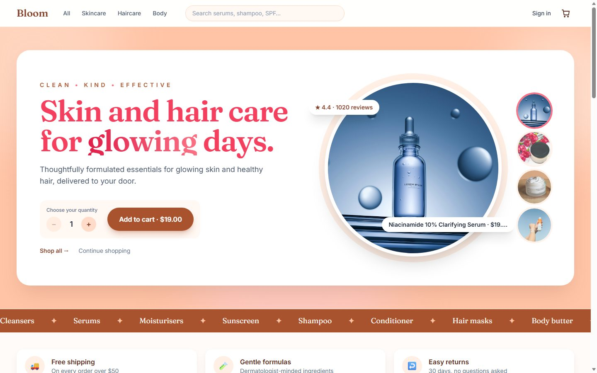
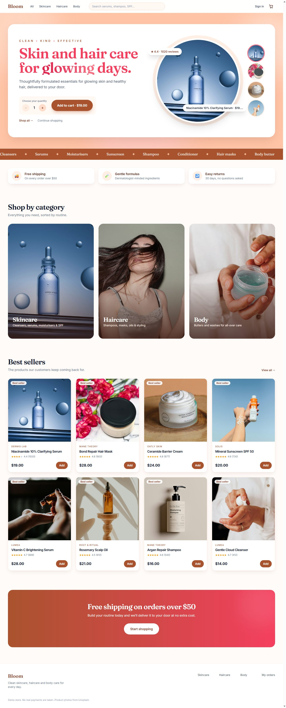
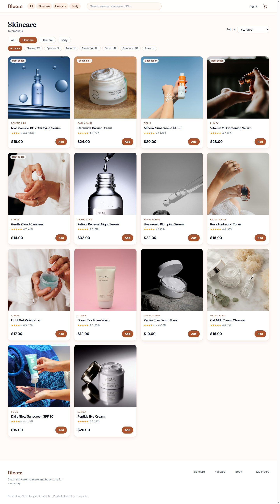
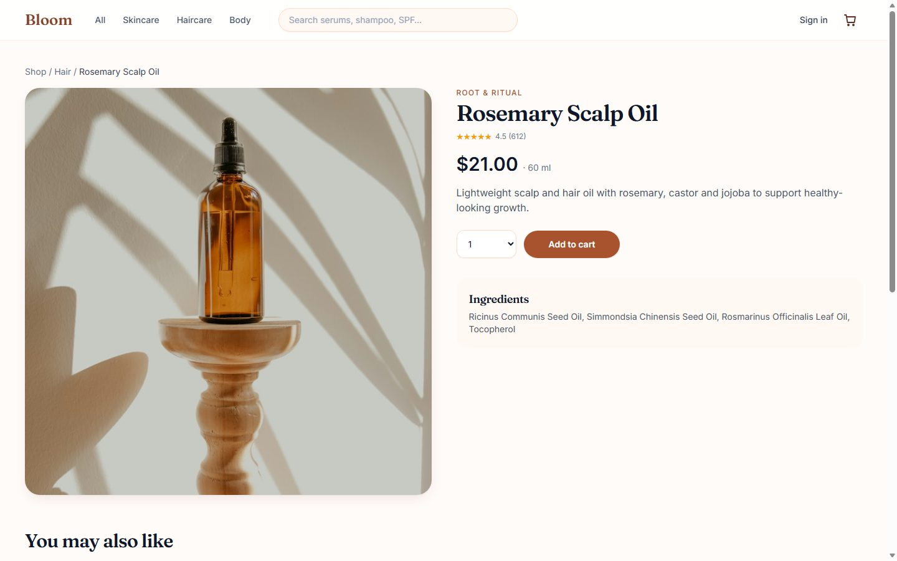
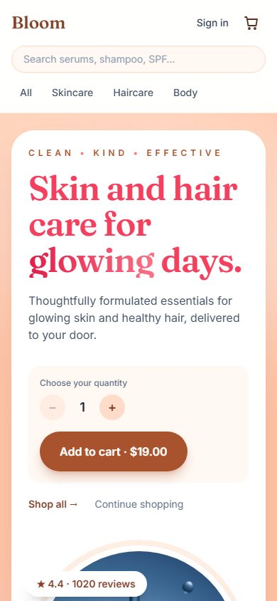
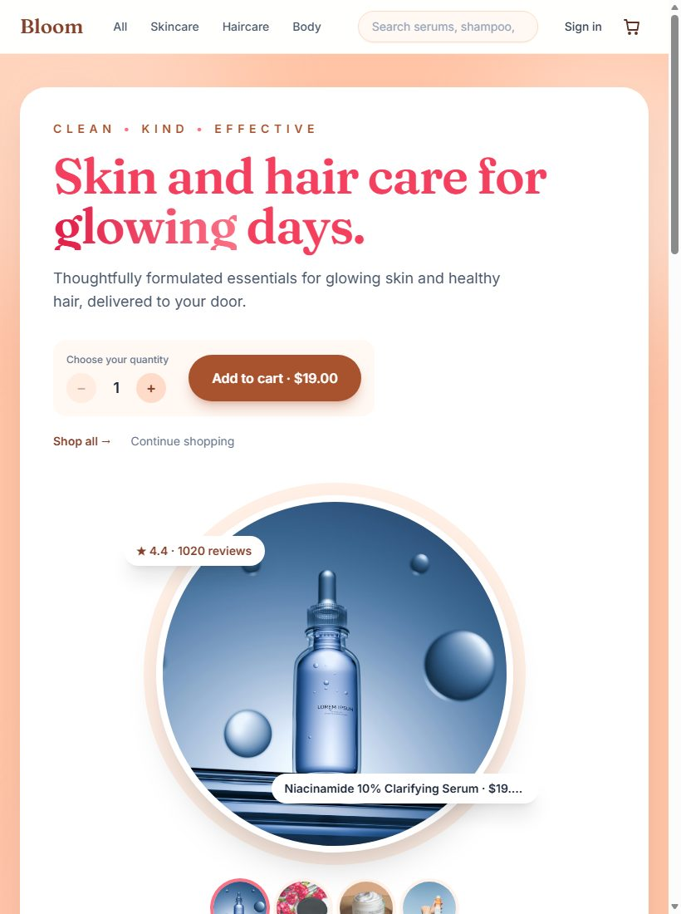
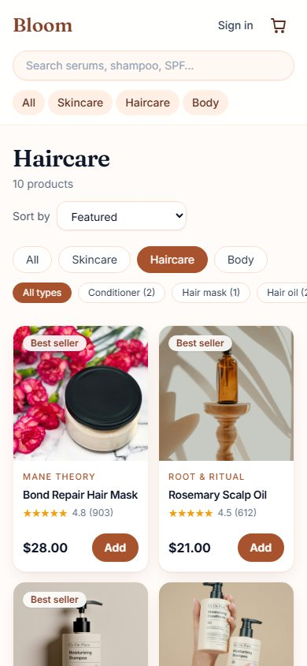

# Bloom — skincare & haircare store

Full-stack demo e-commerce site for skin, hair and body products. React (Vite) + Tailwind CSS 3.4 on the front, Node/Express + SQLite on the back. Everything runs locally.



## Screenshots

### Home page



Top to bottom:

1. **Hero.** A white card on a peach background. The headline's last word rotates through *glowing, healthy, radiant, soft*. On the right is a round showcase of a best-selling product. Click one of the small round thumbnails to switch the product, use the **− / +** stepper to pick a quantity, and press **Add to cart** (the button shows the running price) to put it straight in the cart.
2. **Ticker.** A scrolling strip of product types.
3. **Perks.** Free shipping over $50, gentle formulas, easy returns.
4. **Shop by category.** Three photo tiles linking to Skincare, Haircare and Body.
5. **Best sellers.** The featured products from the API, each card with a rating, price and quick **Add** button.
6. **Shipping banner and footer.**

Sections fade in as you scroll. All motion is switched off for visitors who have "reduce motion" turned on in their operating system.

### Shop page



Filter by category (Skincare, Haircare, Body), narrow by product type (cleanser, serum, shampoo, …) and sort by featured, rating, price or name. The URL holds the filters (`/shop?category=skin&type=serum&sort=price-asc`), so a filtered view can be bookmarked or shared. The search box in the header feeds the same page (`/shop?q=serum`).

### Product page



A large photo, brand, rating, price and size, a quantity picker, the ingredient list and a "You may also like" row. A low-stock warning appears at 10 or fewer, and the button is disabled once the cart already holds all the available stock.

### Responsive layout

| Phone (390 px) | Tablet (820 px) |
| --- | --- |
|  |  |



- **Phone.** The header stacks: logo and cart, then search, then a row of category links. The hero card becomes a single column with the round product below the copy, and the shop grid has two columns. Filter chips scroll sideways instead of wrapping.
- **Tablet.** Single-column hero, three-column product grid, and the header fits on one row.
- **Desktop.** Content is capped at 1440 px. The hero is two columns and the product grid has four.

I checked home, shop, product, cart and sign-in pages at 320, 390, 768, 1024 and 1440 px wide. None scroll sideways or log JavaScript errors.

*Screenshots are taken with the "reduce motion" setting on, so the rotating headline word holds still.*

## Run it

Needs Node 22.13+ (it uses the built-in `node:sqlite`).

```powershell
# terminal 1 — API on http://localhost:4000
cd backend
npm install
npm run dev

# terminal 2 — site on http://localhost:5173
cd frontend
npm install
npm run dev
```

Start the backend first. The catalog (26 skin, hair and body products) is seeded automatically on first start. `npm run seed` in `backend` resets it, unless orders already exist.

**If port 4000 is already taken** (the site will then show another app's data, or no products), run the API on a different port and tell the frontend where it is:

```powershell
# terminal 1
cd backend
$env:PORT = "4100"; npm run dev

# terminal 2
cd frontend
$env:API_URL = "http://localhost:4100"; npm run dev
```

## Features

- Browse, filter by category and product type, search, and sort
- Product pages with ingredients, stock warnings and related products
- Cart saved in the browser, free shipping over $50
- Accounts (register / sign in, scrypt-hashed passwords, JWT sessions)
- Checkout and order history. Prices and stock are always checked on the server, and stock is decremented in a transaction.

## Notes

- **Payments are a local stand-in**: placing an order marks it `paid`. Real payment and email providers are intentionally not wired up yet.
- The JWT signing key is generated into `backend/data/jwt.secret` (gitignored), or set `JWT_SECRET`.
- The database lives in `backend/data/ecom.db` (gitignored). Delete it to start fresh.
- Product photos are free Unsplash images stored locally in `frontend/public/images/products/<slug>.jpg`. Several products share a stock photo, so swap in real product shots when you have them.
- **Theme.** Every colour comes from one setting, `ACTIVE_PALETTE`, at the top of `frontend/tailwind.config.js`. It is `'peach'` (peach, brown and rose pink); change it to `'blue'` for the light-blue version. Restart the dev server after changing it.
- Fonts are bundled locally via `@fontsource`, so the site makes no third-party requests.

## API

| Method | Path | Notes |
| --- | --- | --- |
| GET | `/api/products` | `category`, `type`, `q`, `sort`, `featured=1` |
| GET | `/api/products/meta` | categories and types with counts |
| GET | `/api/products/:slug` | includes `related` |
| POST | `/api/auth/register`, `/api/auth/login` | returns `{ token, user }` |
| GET | `/api/auth/me` | auth required |
| GET, POST | `/api/orders` | auth required |
| GET | `/api/orders/:id` | own orders only |
